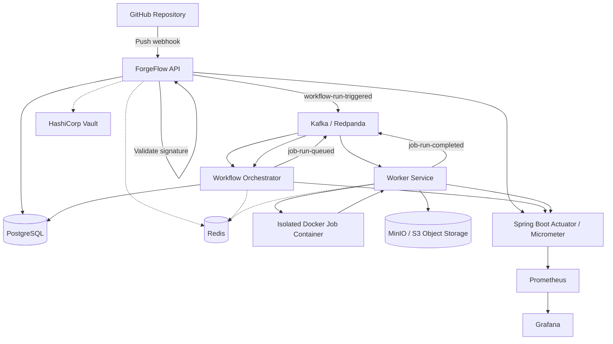

# ForgeFlow | Cloud-Native CI/CD Platform

A custom, event-driven CI/CD platform built with **Java 21, Spring Boot, Apache Kafka, Docker, PostgreSQL, and Redis**, with integrated artifact storage, secrets management, and observability.

ForgeFlow is designed to automate workflow execution, orchestrate dependent jobs, execute shell steps in isolated containers, and provide visibility into execution through logs and metrics.

The project explores the engineering challenges behind CI/CD systems, including asynchronous processing, dependency-aware scheduling, distributed coordination, artifact management, containerized execution, and monitoring.

---

## Table of Contents

- [Overview](#overview)
- [Architecture](#architecture)
- [Execution Flow](#execution-flow)
- [Key Features](#key-features)
- [Technology Stack](#technology-stack)
- [System Components](#system-components)
- [Observability and Monitoring](#observability-and-monitoring)
- [Reliability and Design Decisions](#reliability-and-design-decisions)
- [Security Considerations](#security-considerations)
- [Project Structure](#project-structure)
- [Getting Started](#getting-started)
- [Testing](#testing)
- [Future Improvements](#future-improvements)
- [Author](#author)

---

## Overview

Modern CI/CD systems coordinate multiple operations: receiving source-control events, scheduling jobs, resolving dependencies, executing build steps, storing artifacts, and reporting results.

ForgeFlow implements these responsibilities through a modular, event-driven architecture.

Instead of coupling workflow orchestration directly to job execution, the platform uses Kafka events to communicate between the API, orchestrator, and worker components. PostgreSQL stores durable application state, while Redis provides coordination capabilities for distributed execution.

The project is inspired by the engineering concepts behind tools such as GitHub Actions and Jenkins, but is implemented as a custom platform.

### Project Goals

- Build an event-driven workflow execution system.
- Implement DAG-based job dependency resolution.
- Execute shell commands inside resource-constrained Docker containers.
- Coordinate asynchronous services through Kafka.
- Manage workflow artifacts using S3-compatible object storage.
- Handle duplicate-delivery risks through Redis coordination and durable state.
- Integrate centralized secrets management.
- Expose application metrics and service health information.
- Automate the local development environment.

---

## Architecture

The following diagram illustrates the major components and their responsibilities.



*Dashed lines indicate supporting integrations; exact component interactions depend on the implemented configuration.*

### Architectural Principles

**Separation of responsibilities:** API handling, workflow orchestration, and job execution are separated into distinct responsibilities.

**Asynchronous communication:** Kafka transports workflow and job events between components.

**Durable state:** PostgreSQL remains the source of truth for persistent workflow and job records.

**Ephemeral coordination:** Redis supports coordination and messaging operations without replacing durable database state.

**Isolated execution:** Job steps run in Docker containers with configured resource constraints.

**Observable operation:** Metrics and health endpoints expose information that can be collected by Prometheus and visualized in Grafana.

---

## Execution Flow

A typical workflow follows this sequence:

1. **Webhook reception:** GitHub sends a repository event to the ForgeFlow webhook endpoint.
2. **Signature verification:** The API validates the webhook signature using HMAC-SHA256.
3. **Workflow registration:** The workflow run is recorded in PostgreSQL.
4. **Event publication:** The API publishes a `workflow-run-triggered` event to Kafka.
5. **Workflow orchestration:** The orchestrator consumes the event and evaluates the workflow's job dependency graph.
6. **Job scheduling:** Eligible jobs are queued through the `job-run-queued` Kafka topic.
7. **Job execution:** A worker executes the job's shell steps in a Docker container.
8. **Artifact and log handling:** Execution output and supported artifacts are persisted through the configured storage integrations.
9. **Completion reporting:** The worker publishes a `job-run-completed` event.
10. **State and metrics updates:** The orchestrator processes completion, updates workflow state, and records execution metrics.

### Event Topics

| Kafka Topic | Purpose |
|---|---|
| `workflow-run-triggered` | Communicates that a workflow run has been triggered. |
| `job-run-queued` | Communicates that a job is ready for worker execution. |
| `job-run-completed` | Communicates job completion back to the orchestration layer. |

Kafka provides asynchronous message delivery. Because message delivery and consumer processing can be repeated, the application must handle retries and duplicate events safely.

---

## Key Features

### 1. GitHub Webhook Integration

- Receives GitHub repository events.
- Validates webhook signatures using HMAC-SHA256.
- Registers workflow runs and initiates asynchronous processing.

**Webhook endpoint:** `POST /api/v1/webhooks/github`

### 2. Event-Driven Processing

- Uses Kafka for communication between application components.
- Separates workflow triggering from job execution.
- Includes handling for message publication failures.

### 3. DAG-Based Workflow Orchestration

- Models dependencies between jobs as a directed acyclic graph.
- Validates dependency relationships.
- Schedules jobs according to dependency completion.
- Supports workflow artifact relationships through `produces` and `consumes` declarations.

### 4. Containerized Job Execution

- Executes shell steps in Docker containers.
- Applies configured memory and CPU constraints.
- Uses containerized execution to separate build commands from the orchestration process.

Containerization provides a useful isolation boundary, but should not be treated as a complete security boundary for arbitrary untrusted code without additional hardening.

### 5. Artifact Management

- Supports packaging workflow artifacts.
- Uses S3-compatible object storage.
- Associates artifacts with workflow execution.
- Includes path validation to mitigate archive path traversal vulnerabilities.

### 6. Redis-Based Coordination

Redis is used for coordination tasks where temporary shared state is useful.

The design keeps persistent workflow and job state in PostgreSQL while using Redis to help coordinate execution and reduce duplicate processing.

This approach acknowledges Kafka's at-least-once delivery behavior rather than assuming exactly-once execution.

### 7. Logging and Execution Visibility

The platform includes execution logging capabilities and supporting infrastructure for log delivery and storage.

Where configured, Redis Pub/Sub and WebSocket/STOMP provide mechanisms for streaming logs to clients.

### 8. Secrets Management

HashiCorp Vault is integrated into the local development environment for secrets management.

Development-mode Vault configuration is intended for local use and must not be reused as a production security configuration.

### 9. Health Checks and Metrics

- Spring Boot Actuator health endpoints.
- Prometheus-compatible metrics.
- Custom workflow, job, and step execution metrics.
- JVM and database connection-pool metrics where available.
- Prometheus and Grafana integration for monitoring.

---

## Technology Stack

| Technology | Purpose |
|---|---|
| Java 21 | Primary programming language |
| Spring Boot | Backend application framework |
| Spring Boot Actuator | Health checks and application metrics endpoints |
| Micrometer | Application metrics instrumentation |
| Apache Kafka | Asynchronous event transport |
| Redpanda | Kafka-compatible local messaging infrastructure |
| PostgreSQL | Durable relational data storage |
| Redis | Distributed coordination and ephemeral messaging |
| Docker | Containerized job execution |
| MinIO / S3 | Artifact and object storage |
| HashiCorp Vault | Secrets management |
| Prometheus | Metrics collection |
| Grafana | Metrics visualization and dashboards |
| JUnit | Automated testing |
| Testcontainers | Container-backed integration testing |
| Docker Compose | Local infrastructure orchestration |
| PowerShell | Local startup and shutdown automation |

---

## System Components

### API Layer

Responsible for receiving webhooks, validating incoming requests, managing workflow definitions, and initiating workflow runs.

### Workflow Orchestrator

Coordinates workflow execution, resolves DAG dependencies, manages job scheduling, and processes job completion events.

### Worker Service

Consumes eligible job events, executes shell steps inside Docker containers, collects execution output, handles supported artifacts, and reports completion.

### PostgreSQL

Stores durable application state, including workflow and job execution records.

### Kafka / Redpanda

Carries asynchronous events between the API, orchestrator, and worker.

### Redis

Provides temporary coordination and messaging capabilities used by configured application components.

### MinIO / S3

Provides object storage for supported workflow artifacts and execution data.

### HashiCorp Vault

Provides a dedicated secrets-management integration.

### Prometheus and Grafana

Prometheus collects metrics exposed by the application, while Grafana visualizes the collected metrics through dashboards.

---

## Observability and Monitoring

ForgeFlow integrates application instrumentation with a Prometheus and Grafana monitoring stack.

### Metrics Endpoint

```text
http://localhost:8080/actuator/prometheus
```

### Health Endpoint

```text
http://localhost:8080/actuator/health
```

### Example Prometheus Query

```promql
up{job="forgeflow-api"}
```

A value of `1` indicates that Prometheus successfully scraped the configured target.

### Custom Application Metrics

The application includes custom metrics for workflow, job, and step execution.

Examples of metric families include:

- `forgeflow_workflow_runs_total`
- `forgeflow_job_runs_total`
- `forgeflow_step_runs_total`

Execution duration metrics are also instrumented for workflow, job, and step processing.

Custom metrics may only appear after the relevant execution path has run, depending on when the application registers the meters.

### Monitoring Stack

The local stack provisions Prometheus and Grafana configuration for the ForgeFlow API. A dashboard named **ForgeFlow Operations** is configured for viewing application and execution metrics.

---

## Reliability and Design Decisions

### PostgreSQL as the Source of Truth

Durable workflow and job state belongs in the relational database. Temporary coordination data should not replace persistent execution records.

### Kafka for Asynchronous Communication

Kafka decouples workflow triggering, orchestration, and worker execution. However, consumers must account for redelivery, retries, and failure recovery.

### Redis for Coordination

Redis is appropriate for temporary coordination state and distributed locking. It does not independently guarantee that a job's external side effects execute exactly once.

### Docker for Job Isolation

Containerized execution limits the direct coupling between the worker service and job commands. Resource limits help control consumption, but stronger isolation is required for hostile workloads.

### Integration Testing

Testcontainers allows integration tests to exercise real dependencies in containerized environments, helping identify issues that unit tests alone may miss.

---

## Security Considerations

Security is particularly important for a CI/CD platform because workflows may execute shell commands and process external input.

- Validate GitHub webhook signatures.
- Avoid logging secrets or sensitive environment variables.
- Keep credentials and signing keys out of source control.
- Use appropriately scoped secrets and access permissions.
- Validate artifact paths and archive extraction destinations.
- Apply container resource limits and appropriate execution restrictions.
- Secure Docker daemon access.
- Use hardened Vault configuration outside local development.
- Validate Redis locking, expiry, and failure behavior.
- Handle Kafka redelivery and job retries without assuming exactly-once execution.

The local development stack is not automatically suitable for public or production deployment. Production use requires additional security review, hardened configuration, and testing of failure and isolation boundaries.

---

## Project Structure

Important repository files and directories include:

| Path | Responsibility |
|---|---|
| `pom.xml` | Maven dependencies and build configuration |
| `docker-compose.yml` | Local infrastructure services |
| `scripts/start-forgeflow.ps1` | Local environment startup automation |
| `scripts/stop-forgeflow.ps1` | Local application and container shutdown |
| `src/` | Application source code and tests |
| `application.yml` | Spring Boot application configuration |
| Prometheus configuration | Scrape targets and monitoring settings |
| Grafana provisioning | Datasource and dashboard configuration |

The exact source-package and provisioning paths should be checked against the repository.

---

## Getting Started

### Prerequisites

Install the following:

- Java 21
- Maven, or the project's Maven Wrapper
- Docker Desktop
- Docker Compose
- Git

### 1. Clone the Repository

```bash
git clone <YOUR_GITHUB_REPOSITORY_URL>
cd ForgeFlow
```

Replace the placeholder with the URL of your actual GitHub repository.

### 2. Start the Local Environment

On Windows, open PowerShell in the project root and run:

```powershell
.\scripts\start-forgeflow.ps1
```

The startup script is designed to check prerequisites, start the local infrastructure, wait for service readiness, initialize the required Vault secret, launch the API, and validate application health and monitoring connectivity.

To start the infrastructure without launching the API:

```powershell
.\scripts\start-forgeflow.ps1 -SkipApi
```

### 3. Verify Application Health

Open:

```text
http://localhost:8080/actuator/health
```

The response should report the application's health status.

### 4. Explore Prometheus

Open:

```text
http://localhost:9090
```

Run the query:

```promql
up{job="forgeflow-api"}
```

Confirm that the configured API target is being scraped successfully.

### 5. Explore Grafana

Open:

```text
http://localhost:3000
```

Sign in using the credentials configured for your local environment and open the provisioned **ForgeFlow Operations** dashboard.

Do not assume default credentials if your local configuration specifies different values.

### 6. Stop the Environment

To stop the API process managed by the script:

```powershell
.\scripts\stop-forgeflow.ps1
```

To stop the API and the Compose containers:

```powershell
.\scripts\stop-forgeflow.ps1 -StopContainers
```

---

## Testing

ForgeFlow includes unit and integration tests for application behavior and infrastructure integrations.

Run the Maven test suite from the project root:

```bash
mvn test
```

If the project includes a Maven Wrapper, use the wrapper command for your operating system.

Integration tests using Testcontainers require a working Docker environment and any required test configuration.

Before publishing test counts in project documentation, run the suite and confirm the actual results.

---

## Future Improvements

Potential future improvements include:

- Cloud deployment and infrastructure automation.
- More comprehensive workflow cancellation and retry policies.
- Stronger sandboxing for untrusted job execution.
- Expanded API documentation and workflow examples.
- More integration tests for failure recovery and duplicate event delivery.
- Alerting rules and additional operational dashboards.
- Improved workflow history and execution visualization.

---

## Author

**Aprajita Srivastava**

B.Tech in Computer Science and Engineering (IoT)

Interested in Java backend engineering, distributed systems, and cloud-native infrastructure.

---

*ForgeFlow is a learning and engineering project focused on understanding the design and implementation of a custom CI/CD platform.*
